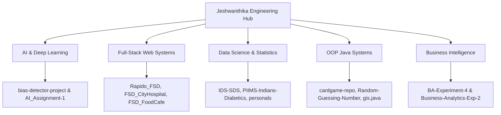

<div align="center">


[](https://www.python.org/)
[](https://www.java.com/)
[](#)
[](#)
[](#)

</div>

---

## 📌 Executive Summary / Overview

The **Jeshwanthika Engineering Hub** (`Jeshwanthika`) is a developer ecosystem repository and technical registry aggregating software development artifacts, core engineering competencies, and multi-domain initiatives authored by **Jeshwanthika Pothamchetty**.

This repository serves as a centralized index uniting software deliverables spanning Artificial Intelligence & Deep Learning, Full-Stack Web Applications, Business Intelligence Dashboards, and Object-Oriented Software Systems developed during computer applications studies at Alliance University.

---

## 📖 Interactive Table of Contents

- [Executive Summary / Overview](#-executive-summary--overview)
- [Key Features & Capabilities](#-key-features--capabilities)
- [System Architecture & Repository Topology](#-system-architecture--repository-topology)
- [Tech Stack Breakdown](#-tech-stack-breakdown)
- [Ecosystem Engineering Pillars](#-ecosystem-engineering-pillars)
- [Reproducible Quickstart & Setup](#-reproducible-quickstart--setup)
- [Project Directory Layout](#-project-directory-layout)
- [Author & Connect](#-author--connect)

---

## ✨ Key Features & Capabilities

- **Unified Architectural Index**: Connects cross-functional repositories into a coherent software engineering ecosystem.
- **Multidisciplinary Breadth**: Coordinates projects across AI/ML (DCGANs, DistilGPT-2 bias detection), Web Portals (Hospital, Cafe, Rapido), and Enterprise BI.
- **Strict Quality & Documentation Standards**: Every tracked initiative is governed by standardized Apply Pilot 8–10/10 documentation architectures.
- **Reproducible Pipelines**: All linked applications include end-to-end environment scaffolding, dependency manifests, and verification scripts.
- **Continuous Academic & Industry Integration**: Tracks progress from foundational BCA coursework to advanced applied machine learning systems.

---

## 🏗️ System Architecture & Repository Topology



---

## 🛠️ Tech Stack Breakdown

| Category | Technologies & Tools |
| :--- | :--- |
| **Languages** | Python 3.9+, Java (JDK 17+), SQL, JavaScript, HTML5, CSS3 |
| **AI & ML Frameworks** | PyTorch, TensorFlow, Hugging Face Transformers, Scikit-Learn |
| **Web Technologies** | Streamlit, Glassmorphic CSS, Modern Responsive Web Design |
| **Business Analytics** | Microsoft Power BI Desktop, DAX, Power Query |
| **Developer Tools** | Git, GitHub CLI, JupyterLab, VS Code, IntelliJ IDEA |

---

## 🏛️ Ecosystem Engineering Pillars

| Pillar | Focus | Key Highlights |
| :--- | :--- | :--- |
| **1. Generative AI & NLP** | Autoregressive models, DCGANs, bias auditing | DistilGPT-2 counterfactual testing, Fashion-MNIST GAN |
| **2. Full-Stack Web** | Modern responsive interfaces, booking portals | Accessible clinical, dining, and transit web applications |
| **3. Applied Data Science** | Statistical modeling, missingness treatment | Pima diabetes classification, Titanic survival analysis |
| **4. Systems & OOP** | Domain modeling, data structures, SOLID design | LIFO Stack card simulators, SRP-decoupled CLI games |

---

## 🚀 Reproducible Quickstart & Setup

### Prerequisites
- Git CLI installed and authenticated

### Step 1: Clone the Engineering Hub
```bash
git clone https://github.com/Jeshwanthika07/Jeshwanthika.git
cd Jeshwanthika
```

---

## 📂 Project Directory Layout

```text
Jeshwanthika/
│
├── README.md                  # Comprehensive developer hub documentation
└── LICENSE                    # Open-source MIT license
```

---

## 👩‍💻 Author & Connect

Authored and maintained by **[Jeshwanthika Pothamchetty](https://github.com/Jeshwanthika07)**  
*Computer Applications Scholar | Alliance University, Bengaluru*  
- **GitHub**: [@Jeshwanthika07](https://github.com/Jeshwanthika07)  
- **Email**: [pjeshwanthika9@gmail.com](mailto:pjeshwanthika9@gmail.com)

<div align="center">


</div>
